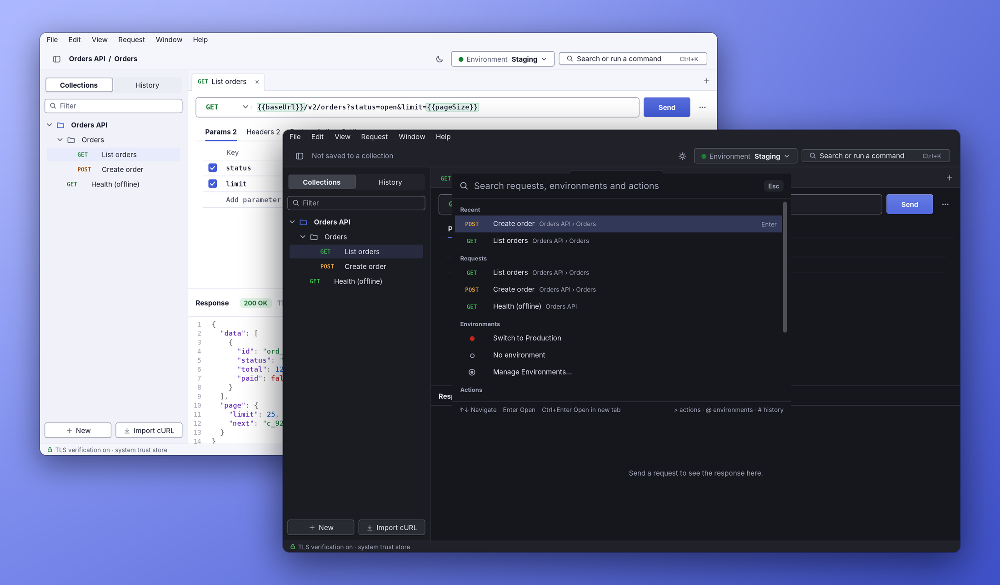
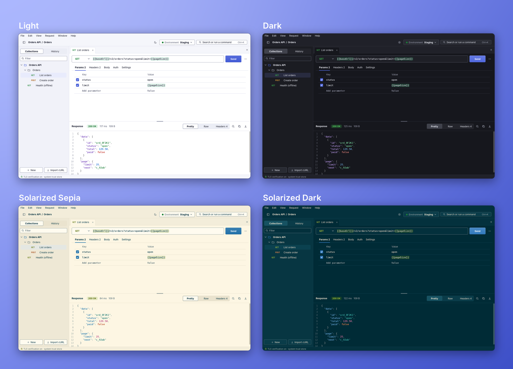
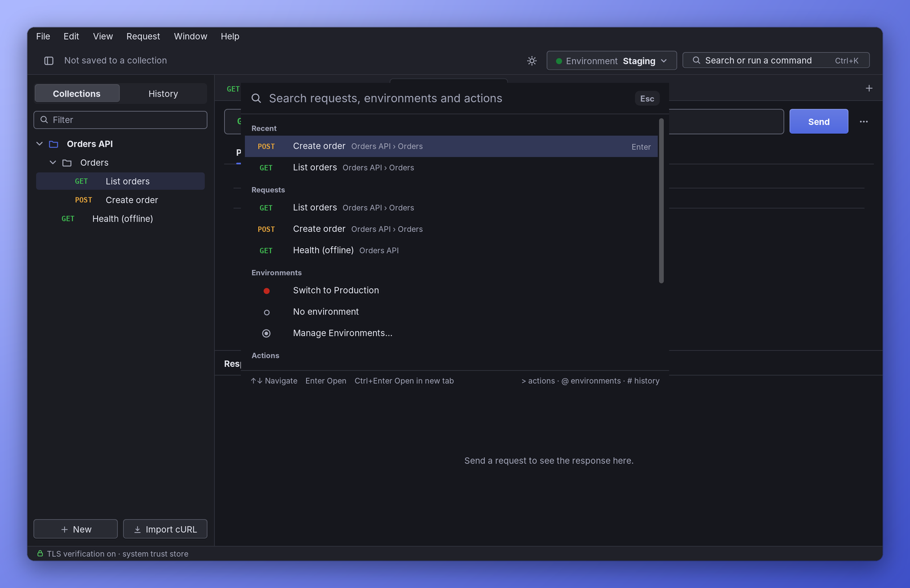
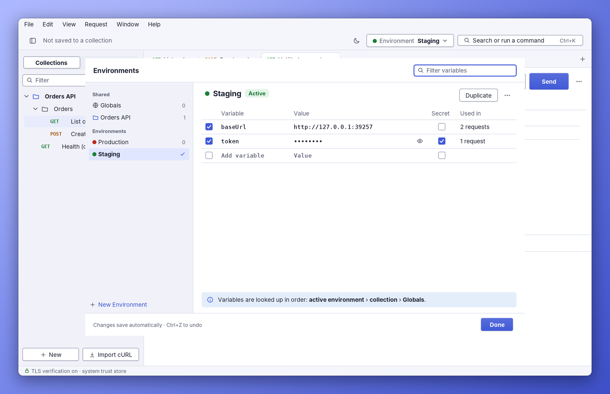
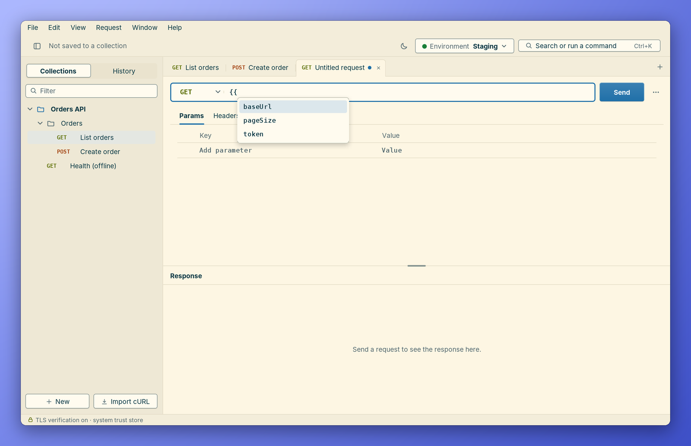
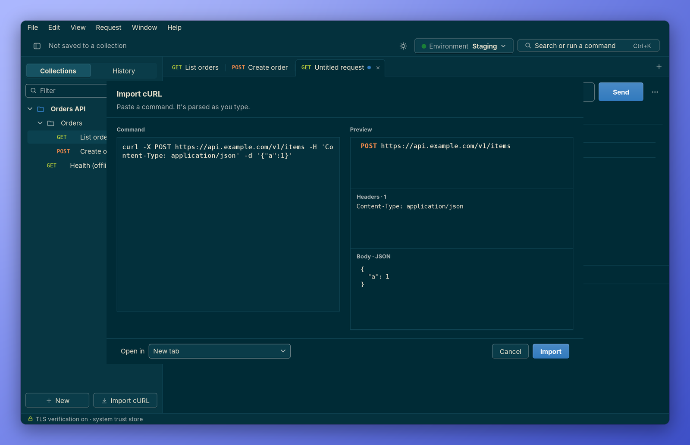
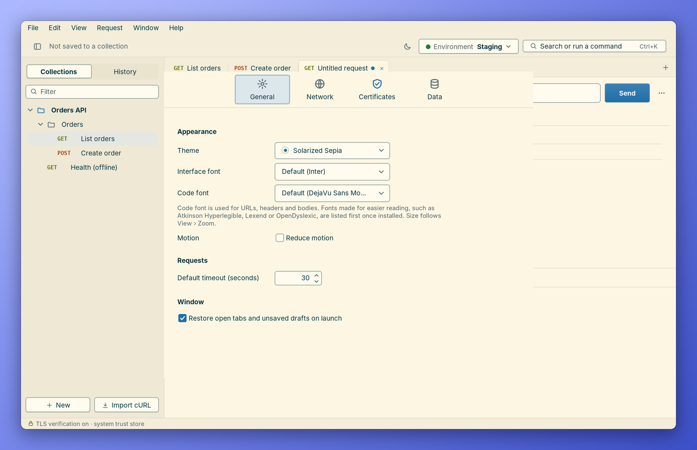
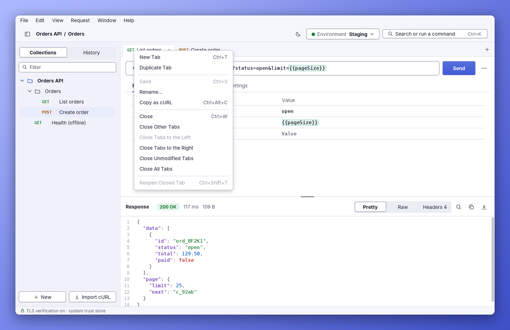

<div align="center">

# REST Client

**A lightweight desktop REST client in pure Java. One JAR, zero dependencies, no accounts, no cloud.**




</div>

Everything is stored as plain JSON in `~/.restclient`.

> **A hobby project, built with Claude.** This app was designed and written in conversation with
> [Claude](https://claude.ai) (Anthropic's AI assistant): wireframes, code, tests and this README.
> It is **not meant for serious or production work**. It's a personal tool and an experiment in what a
> dependency-free Swing app can look like. That said, **it works**: it sends real requests, keeps your
> collections and environments, and has unit tests and an automated UI check behind it. Use it, poke at
> it, and keep a backup of anything you care about in `~/.restclient`.
>
> **Not taking requests.** Issues, feature requests and pull requests aren't being accepted. You're
> free to **fork it** and make it your own under the [MIT License](LICENSE).

**Zero third-party dependencies.** Everything — the look and feel, icons, code editor, JSON library and
test kit — is in this repository, and the build needs nothing but a JDK. See [Dependencies](#dependencies).

- Collections with folders, drag-and-drop reordering, duplicate, rename, and delete (with Undo)
- Environments, collection variables and globals with `{{variable}}` syntax
  - hover a variable to see its value and where it comes from; ⌘/Ctrl-click to jump to it
  - undefined variables are underlined in red, with a one-click "Define…"
  - autocomplete after typing `{{`
  - built-in values made up per request: `{{$guid}}`, `{{$timestamp}}`, `{{$isoTimestamp}}`, `{{$randomInt}}`…
- **Capture**: save a value from a response (a JSON field, a header, a cookie, the status) into a variable
  for the next request to use, with no scripting
- File uploads: multipart form-data with text and file parts, or one file as the whole body
- Recent history, grouped by day, with read-only snapshots (secrets masked)
- Responses: Pretty, Raw, Headers and Request views, find, copy and save. *Request* shows what was actually
  sent: the URL and headers with variables filled in (secret values hidden) and the body. In Headers, ⌘C / Ctrl+C copies the selected
  rows as `Name: Value` lines, right-click offers Copy Value / Name / Row / All Headers, and the Copy button
  copies them all. Drag the column divider to resize; double-click it to fit the names.
- cURL import (paste into any URL field, or the import dialog) and export
- Copy as code: Java `HttpClient`, Python `requests`, JavaScript `fetch`, PowerShell
- Postman import and export: collections (v2.0 and v2.1) and environments
- OpenAPI 3 and Swagger 2 import, JSON or YAML (read by the app's own YAML reader)
- A sample collection that tours every feature against httpbin.org (added on first launch)
- TLS: extra trusted certificates and client certificates from `~/.restclient/certs`,
  a "Trust this certificate" flow, and per-request or default "skip verification" (certificate **and** hostname)
- Command palette (⌘K / Ctrl+K), Light, Dark, Solarized Sepia and Solarized Dark themes (or follow the OS), choosable interface and code fonts, tabs and drafts restored on relaunch

## Screenshots

<div align="center">



<sub>Four themes (Light, Dark, Solarized Sepia, Solarized Dark) or follow the OS, all checked for WCAG AA contrast.</sub>

</div>

<table>
  <tr>
    <td width="50%"><br>
      <b>Command palette</b><br><sub>⌘K / Ctrl+K to jump to any request, environment or action.</sub></td>
    <td width="50%"><br>
      <b>Environments and variables</b><br><sub>Secrets, usage counts and a clear lookup order.</sub></td>
  </tr>
  <tr>
    <td><br>
      <b>Variable autocomplete</b><br><sub>Type <code>{{</code> anywhere for a list of defined variables.</sub></td>
    <td><br>
      <b>cURL import</b><br><sub>Paste a command and see it parsed as you type.</sub></td>
  </tr>
  <tr>
    <td><br>
      <b>Themes and fonts</b><br><sub>Pick interface and code fonts; readable fonts listed first.</sub></td>
    <td><br>
      <b>Tabs that behave</b><br><sub>Duplicate, close others / left / right, reopen closed tabs.</sub></td>
  </tr>
</table>

## Build and run

Requirements: **JDK 17 or newer**. Nothing else — no Maven, no Gradle, no downloads.

```bash
java Build.java          # compile, run the tests, build build/restclient.jar
java -jar build/restclient.jar
```

Other tasks: `java Build.java jar` (skip tests), `java Build.java test`, `java Build.java run`,
`java Build.java clean`. `Build.java` is a single-file Java program that drives `javac` and `jar` from
the JDK. The JAR (~470 KB) runs on macOS, Windows and Linux.

A `pom.xml` with no dependencies is included only so IDEs can import the project; note that Maven itself
downloads its plugins from Maven Central.

To use a different data folder (handy for trying things out):

```bash
java -Drestclient.home=/tmp/rc-sandbox -jar build/restclient.jar
```

## Where data lives

```
~/.restclient/
  collections/      one JSON file per collection (e.g. orders-api-1a2b3c4d.json)
  environments/     one JSON file per environment, plus globals.json
  certs/            extra trusted certificates and keystores (see below)
  history.json      recent requests (default: last 200)
  settings.json     preferences, keystore passwords, active environment
  session.json      open tabs (including unsaved drafts) and window layout
```

All files are human-readable JSON and are written atomically (temp file + rename), so a crash
can't leave a half-written file. If a file can't be read, it's renamed to `*.corrupt-<timestamp>`
and the app starts with defaults, telling you in the status bar.

## Environments and variables

Use `{{name}}` anywhere: URL, params, headers, body, auth fields.

Lookup order (first match wins):

1. the request's own **local variables** (Params › *Local variables*)
2. the **active environment** (picker in the toolbar, or ⌘E / Ctrl+E)
3. the **collection** the request belongs to
4. **Globals**

Variables can be disabled or marked **secret**. Secret values are masked in the UI, in hover popovers
(until you click *Reveal*), and in history snapshots. Values may themselves contain variables.

Manage them in **Request › Manage Environments…** — edits save automatically, ⌘Z / Ctrl+Z undoes,
and the *Used in* column shows how many saved requests reference each variable.

## Certificates and TLS

### Trusting extra certificates

Drop files into `~/.restclient/certs`, then click **Reload** in Settings › Certificates
(or restart). Supported:

| File | Used as |
|---|---|
| `.pem` `.crt` `.cer` `.der` | trusted certificates (PEM bundles with several certificates are fine) |
| `.p12` `.pfx` `.jks` `.keystore` with only certificates | trusted certificates (a truststore) |
| `.p12` `.pfx` `.jks` `.keystore` with a private key | **client certificate** for mTLS |

These are **added to** the JDK's default trust store, so public sites keep working.
Keystore passwords are set per file in Settings › Certificates (`changeit` and an empty password are
tried automatically). A file that fails to load is listed with the reason; the others still load.

When a server's certificate isn't trusted, the response pane offers **View & Trust…**, which shows
the chain (subject, issuer, validity, SHA-256 fingerprint), saves the chosen certificate as PEM into
the certs folder, reloads, and can re-send the request.

### Skipping verification

Per request (Settings tab, the ⋯ menu, or *Retry Insecurely* on a TLS error), or as the default
(Settings › Certificates). While it's on, an orange **TLS verification off** badge sits next to Send.

Skipping turns off **both** certificate-chain validation **and** hostname verification.
How: `java.net.http.HttpClient` performs hostname checks inside the trust manager when that trust manager
is an `X509ExtendedTrustManager`. The skip context uses a no-op `X509ExtendedTrustManager`, so neither
check runs — for that request only. The alternative, the JVM-wide system property
`jdk.internal.httpclient.disableHostnameVerification`, is read once at startup and would also weaken
verified requests, so it is deliberately **not** used. Verified and skipped requests use two separate
`HttpClient` instances. (`TlsManagerTest` checks this end to end against a local HTTPS server.)

### Local variables

A request can carry its own variables: **Params › Local variables**. They apply to that request only and win
over every other scope, so you can try a different `userId` or point one request at another host without
touching the environment. Other requests never see them. Their values can use other variables
(`run-{{$timestamp}}`, `{{host}}/v2`), and hovering a `{{name}}` shows *This request · local* with the value
it overrides.

They are saved with the request, so they're still there next time; switch a row off to go back to the
environment's value. This is the nearest thing to Postman's local variables, which a script sets for one run
and then forgets: the app has no scripts or collection runner, so its locals are typed in and kept.
Postman collections that set locals in a pre-request script import into this table, and exports write them
back the same way; see [Postman](#postman).

### Built-in variables

Names that start with `$` are built in. They get a new value every time a request is sent, and every place
one is used gets its own value. The names are Postman's, so imported requests keep working.

| Variable | Value |
|---|---|
| `{{$guid}}`, `{{$randomUUID}}` | A random UUID |
| `{{$timestamp}}` | The current time in seconds since 1970 |
| `{{$isoTimestamp}}` | The current time as ISO 8601, in UTC |
| `{{$randomInt}}` | A whole number from 0 to 1000 |
| `{{$randomBoolean}}` | `true` or `false` |
| `{{$randomAlphaNumeric}}` | One letter or digit |

They autocomplete once you type `{{$`, and hovering one says what it produces. The *Request* view and
History show the values that were actually sent. You can't define a variable of your own with one of these
names, and other `$names` (Postman has many more, such as `{{$randomEmail}}`) are flagged as not defined.

### Capture: saving values from a response

The **Capture** tab on a request lists values to keep from its response, so a later request can use them:
log in, keep the token, call the API. There is no scripting engine; a rule is a variable name and where to
take the value from.

| Source | Takes |
|---|---|
| `status` | The status code |
| `header.Location` | A response header (the name isn't case-sensitive) |
| `cookie.session` | A cookie the response sets |
| `body` | The whole body as text |
| `body.data.token`, `$.data.token`, `data.token` | A value in a JSON body |
| `body.items[0].id`, `body.items[-1].id` | An item of a list; `-1` is the last |
| `body["odd name"].x` | A name with dots or spaces in it |

After a response, the source column autocompletes with what that response actually contains.

Where the value goes: if the variable already exists, it's updated where it's defined (the definition that
wins: active environment, then the collection, then Globals), and a secret stays secret. A new variable
goes into the active environment, or into Globals when none is selected. The status bar says what was
saved; a rule that finds nothing says why under the response and saves nothing. Failed requests capture
nothing. Values over 64 KB are cut.

## File uploads

The **Body** tab has two upload types:

- **Multipart** sends `multipart/form-data`. Each row is a field; set its *Type* to **File** to pick a file
  to upload instead of typing text. The file's name and a content type guessed from its extension are sent
  with it. The `Content-Type` header, with its boundary, is written for you.
- **File** sends one file as the whole body. `Content-Type` comes from the extension unless you add the
  header yourself.

Paths can contain `{{variables}}`. Files are read when you press Send, so a file that has moved is reported
then, without sending anything. Files are built into the request in memory; the limit is 100 MB each.
History and the *Request* view name the file and its size, and never store its contents.

## cURL

- **Import:** paste a `curl …` command into any URL field and it's imported into that tab, or use
  **File › Import cURL…** (⌘⇧I / Ctrl+Shift+I) for a live preview.
  Supported: `-X/--request`, `-H/--header`, `-d/--data/--data-raw/--data-binary/--data-ascii`,
  `--data-urlencode`, `--json`, `-u/--user`, `-k/--insecure`, `--url`, `-G/--get`, `-I/--head`,
  `-A/--user-agent`, `-e/--referer`, `-b/--cookie`, `-m/--max-time`, `--oauth2-bearer`,
  `-F/--form` and `--form-string` (multipart; `name=@file` uploads), `--data-binary @file` (file body);
  single/double/`$'…'` quoting, `\` line continuations, combined flags like `-sSLk` and `-XPOST`.
  Options that don't apply are listed as *ignored*, never dropped silently; parse errors show the
  line and column.
- **Export:** ⋯ › *Copy as cURL* (⌥⌘C / Ctrl+Alt+C) resolves variables with the active environment;
  *Copy as cURL (keep {{variables}})* leaves them as placeholders. `-k` is added when verification is skipped.

## Copy as code

⋯ › *Copy as Code* (also in the Request menu and the command palette) copies a short, runnable program that
sends the current request:

| Language | Uses |
|---|---|
| Java | `java.net.http.HttpClient` (JDK 11+) |
| Python | `requests` |
| JavaScript | `fetch` (browsers and Node.js 18+; file uploads use Node 20's `openAsBlob`) |
| PowerShell | `Invoke-WebRequest` (`-Form` and `-SkipCertificateCheck` need PowerShell 6+) |

Variables are replaced with their values, including secrets, because the code has to run on its own: treat
the copied text like a password if the request has one. Every value from the request is written as a string
literal with the language's own escaping, so a header or body can't turn into code. "Skip verification" is
carried over where the language has a switch for it (Python, PowerShell) and noted in a comment where it
doesn't.

## Sample collection

A first launch starts with **Sample: httpbin**, a guided tour of the app against
[httpbin.org](https://httpbin.org). That's a free service that echoes back what you send, so you can see the
headers, bodies and auth that actually went out. Its first request is open, ready to send. *Help › Add Sample
Collection* adds a fresh copy any time.

| Folder | What it shows |
|---|---|
| 1 · Basics | GET, query params (one disabled), custom headers (one disabled), PUT, PATCH, DELETE, HEAD, OPTIONS |
| 2 · Request bodies | JSON (try Beautify), XML, plain text and URL-encoded forms, with variables inside |
| 3 · Auth | Basic auth that works and one that gets 401, a Bearer token from a secret variable, a missing token |
| 4 · Responses | JSON, XML, HTML, an image, gzip, response headers to copy, a 3-hop redirect, 404, 500, UTF-8 |
| 5 · Timeouts and errors | A slow request to cancel, a per-request timeout, connection refused, an unknown host |
| 6 · Certificates | [badssl.com](https://badssl.com): self-signed (Trust or Retry Insecurely), wrong host, expired, verification off |
| 7 · Variables | Hover popovers, environment overrides, an undefined variable to Define… |
| 8 · Capture, built-ins, uploads | Capture a UUID from one response and use it in the next; `{{$guid}}` and friends; a multipart form |

The collection's variables (`baseUrl`, `username`, a secret `password` and `token`, `userId`…) live on the
collection. The **Local httpbin (Docker)** environment points it at a local copy instead: run
`docker run -p 8080:80 kennethreitz/httpbin`, then switch to that environment. It also overrides `userId`,
so the *Switch environment* request shows variables changing.

Postman users can import the same tour from [`samples/httpbin.postman_collection.json`](samples/httpbin.postman_collection.json)
and [`samples/local-httpbin.postman_environment.json`](samples/local-httpbin.postman_environment.json).
Postman has no per-request timeout, so that one request runs without its 2 s limit there.
`java Build.java samples` regenerates both files from
[`Samples.java`](src/main/java/dev/restclient/store/Samples.java), and a unit test fails if they drift apart.

## Postman

**Import:** File › *Import from Postman…* takes a Postman collection (v2.0 or v2.1) or a Postman
environment file, and works out which it is. It's added next to what you have, so nothing is replaced; a
second import of the same file becomes "Shop API (2)".

| From Postman | Becomes |
|---|---|
| Folders, requests, methods, headers (including disabled ones) | The same |
| URL as text or as parts; disabled query params; `:id` path variables | The URL, disabled params kept disabled, path variables filled in |
| Raw bodies (JSON, XML, text), `x-www-form-urlencoded` | JSON, XML, Text, Form bodies |
| `form-data` with text and file fields; binary (`file`) bodies | Multipart and File bodies, with the file paths |
| Pre-request lines that set a local variable to a fixed value: `pm.variables.set("userId", "42")` | The request's Local variables; ones set on a folder or the collection go to every request inside |
| Test-script lines that save a value: `pm.environment.set("token", pm.response.json().token)` | Capture rules |
| `{{$guid}}`, `{{$timestamp}}`, `{{$isoTimestamp}}`, `{{$randomInt}}` | The same built-in variables |
| GraphQL body | A JSON body of `{"query", "variables"}` |
| Basic and Bearer auth, including auth set on a folder or the collection | Auth on each request that inherits it; *No Auth* overrides |
| API-key auth | A header or query parameter |
| Collection variables (secret ones stay secret) | Collection variables |
| "SSL certificate verification" off | Skip verification for that request |
| `{{variables}}` | Unchanged; the syntax is the same |

**Variables.** Postman keeps each kind of variable in its own file, and so does the import:

| Postman file | Holds | Imports as |
|---|---|---|
| `*.postman_collection.json` | Collection variables only | The collection's variables |
| `*.postman_environment.json` | One environment | A new environment (status bar: *Use It*) |
| `*.postman_globals.json` | Globals | Merged into Globals |

A collection export never includes environments or globals, so export those from Postman as well. Postman
writes only each variable's *initial value*; a value typed only into *current value* arrives empty.

A globals file is merged: new variables are added, and if some already exist with a different value you
choose *Keep Mine* or *Replace With File's*. A secret left empty in the file never replaces yours. *Undo*
in the status bar puts Globals back as it was.

What can't come across is listed after the import (the status bar's *Details*): pre-request and test
scripts, saved example responses, other auth types (OAuth, Digest, AWS…), and Postman's other dynamic
variables (`{{$randomEmail}}` and the like), which are sent as written.

Scripts are never run. The one thing read out of a test script is the common "save a value" line:
`pm.environment.set`, `pm.globals.set`, `pm.collectionVariables.set` or `postman.setEnvironmentVariable`
with `pm.response.json().path`, a variable holding `pm.response.json()`, `pm.response.headers.get("…")`,
`pm.response.code` or `pm.response.text()`. Those lines become Capture rules; anything else in the script
is reported as left out. On export, Capture rules are written back as such lines, so they work in Postman.

Local variables work the same way. In a pre-request script, `pm.variables.set("name", …)` with a fixed value
becomes a local variable: a quoted string, a number, `true`/`false`, `pm.variables.replaceIn("{{$guid}}")`,
or another variable such as `pm.environment.get("host")` (imported as `{{host}}`). A value that has to be
computed (`Date.now()`, string concatenation, anything with code around it) is not guessed at; that script
is reported as left out. On export, local variables are written as a pre-request script of such lines.

One difference to know: in Postman, `pm.variables.set` in a *test* script keeps a response value for the
rest of a collection run only. There are no runs here, so that line becomes a Capture rule, which saves the
value into the environment or Globals where later requests can use it.

File paths in an imported collection come from the file, and a request that uploads a file sends it to
whatever server the request names. The import says how many requests upload files; check the paths in the
Body tab before sending a collection you didn't write.

**Export:** File › *Export Collection to Postman…*, or right-click a collection › *Export to Postman…*,
writes a Collection v2.1 file that Postman imports directly. URLs are written in Postman's parts form, so
Params show up there. Environments export from the Environments dialog (⋯ › *Export to Postman…*), and
Globals from its *Export to Postman…* button there. If an
environment has secrets, you're asked whether to include their values; by default they're left empty.

Imported files are treated as untrusted. They're read by the app's own JSON parser (nesting is limited)
and capped at 50 MB, and names are cleaned so they can't contain control characters or render as HTML.

## OpenAPI and Swagger

File › *Import OpenAPI or Swagger…* (also under the sidebar's **Import** button) turns an API description
into a collection. It reads OpenAPI 3.0 and 3.1 and Swagger 2.0, in JSON or YAML.

| From the file | Becomes |
|---|---|
| `info.title` | The collection's name |
| The first server (or Swagger's `host` + `basePath`) | A `baseUrl` collection variable; every URL starts with `{{baseUrl}}` |
| Each operation | A request, named from `summary`, then `operationId`, then `GET /path` |
| Tags | Folders (an operation goes in its first tag's folder; untagged ones stay at the top) |
| Path parameters `/orders/{id}` | `/orders/{{id}}` and an `id` collection variable, filled with the example if there is one |
| Query and header parameters | Required ones are switched on, optional ones are listed switched off; values come from `example`, `default` or the first `enum` |
| JSON request bodies | The file's example, or one built from the schema (`$ref`, `allOf`, `oneOf`; read-only fields left out) |
| Form and multipart bodies | Form or Multipart rows; `format: binary` becomes a File row to fill in |
| `http` bearer / basic, `apiKey`, OAuth 2 | Bearer `{{token}}`, Basic `{{username}}`/`{{password}}`, a header or query parameter with `{{apiKey}}`; the secret ones are secret variables |

What isn't imported is listed in *Details*: cookie parameters, TRACE operations, and references to other
files or URLs, which are never fetched. OAuth 2 sign-in isn't run; paste an access token into `token`.

**YAML.** There's no YAML library in the JDK, so the app has its own reader
([`Yaml.java`](src/main/java/dev/restclient/openapi/Yaml.java)) rather than a dependency. It reads the YAML
that API descriptions use: nested mappings and lists, plain and quoted strings, `|` and `>` text blocks,
inline `[a, b]` and `{a: b}`, comments, and anchors with aliases (`&a`, `*a`, `<<`). It doesn't read complex
keys (`? `), it ignores tags, and it reads only the first document in a file. If a file uses something it
can't read, the error names the line; converting the file to JSON always works.

The file is treated as untrusted: it's capped at 20 MB, nesting depth and the total number of values are
limited (aliases are counted at their expanded size, so a "billion laughs" file fails quickly), generated
examples are bounded even when schemas refer to each other in a loop, at most 5,000 operations are
imported, names are cleaned as for Postman imports, and header names are reduced to legal characters.

## Keyboard shortcuts

| Action | macOS | Windows / Linux |
|---|---|---|
| Send | ⌘↩ | Ctrl+Enter |
| New tab | ⌘T | Ctrl+T |
| Close tab | ⌘W | Ctrl+W |
| Save / Save As | ⌘S / ⇧⌘S | Ctrl+S / Ctrl+Shift+S |
| Focus URL | ⌘L | Ctrl+L |
| Switch environment | ⌘E | Ctrl+E |
| Command palette | ⌘K | Ctrl+K |
| Import cURL | ⇧⌘I | Ctrl+Shift+I |
| Copy as cURL | ⌥⌘C | Ctrl+Alt+C |
| Find in response | ⌘F | Ctrl+F |
| Toggle sidebar | ⌃⌘S | Ctrl+B |
| Next / previous tab | ⇧⌘] / ⇧⌘[ | Ctrl+PgDn / Ctrl+PgUp |
| Settings | ⌘, | Ctrl+, |
| Undo / Redo | ⌘Z / ⇧⌘Z | Ctrl+Z / Ctrl+Y |
| Zoom in / out / actual size | ⌘+ / ⌘- / ⌘0 | Ctrl+= / Ctrl+- / Ctrl+0 |
| Toggle light / dark (Light↔Dark, Sepia↔Solarized Dark) | ⇧⌘L | Ctrl+Shift+L |
| Reopen closed tab | ⇧⌘T | Ctrl+Shift+T |
| Context menu (sidebar, history) | ⇧F10 | Shift+F10 / Menu key |

Zoom (75 % to 200 %) scales all text and rows and is remembered between launches; Ctrl+Shift+= and the
numeric-keypad + / - / 0 work too.

All labels in menus, tooltips and the palette come from one keymap (`ui/Keys.java`).
Palette prefixes: `>` actions, `@` environments, `#` history.

## Dependencies

There are none at runtime or build time. What would normally come from libraries is written here:

| Replaces | Lives in | Notes |
|---|---|---|
| FlatLaf (look and feel) | `ui/laf/` | Flat light/dark Swing look and feel on top of Swing's Basic L&F: rounded buttons, fields, combo boxes, spinners, check boxes, slim scroll bars, menus, source-list trees. Visual design inspired by FlatLaf and macOS; no FlatLaf code is included (see `NOTICE`). |
| FlatLaf Extras (SVG icons) | `ui/SvgIcon.java` | Renders the app's own small SVGs (path/rect/circle/ellipse, path commands M L H V C S Q T A Z), re-coloured for the theme at paint time. |
| RSyntaxTextArea (code editor) | `ui/CodeArea.java`, `ui/Lexer.java` | `JTextArea` with per-line JSON/XML/HTML colouring, line numbers and find. |
| Jackson (JSON) | `json/` | RFC 8259 parser and writer, a token-preserving pretty-printer, and a reflection mapper for the public-field model classes. |
| JUnit | `src/test/java/dev/restclient/testkit/` | `@Test`, `@BeforeEach`, `@AfterEach`, assertions and a runner. |

The only code that runs is the JDK and this repository, so the supply chain is the JDK you install.
To check: `unzip -l build/restclient.jar` lists only `dev/restclient/**`, `icons/**` and the manifest.

## Project layout

```
src/main/java/dev/restclient/
  App.java              entry point
  model/                RequestDef, ApiCollection, CollectionNode, Environment, Variable, HistoryEntry, Settings, Session
  store/                AppPaths, JsonStore (atomic JSON), Repository (state + background writes)
  vars/                 VariableResolver (scopes, precedence, masking), DynamicVars ({{$guid}}…)
  http/                 TlsManager, PreparedRequest (incl. multipart), HttpService, ResponseData, MediaTypes
  capture/              Capture (values from a response into variables)
  codegen/              CodeGen (Copy as Code)
  curl/                 ShellTokenizer, CurlParser, CurlExporter
  postman/              Postman collections, environments and globals: import and export
  openapi/              OpenApi (OpenAPI 3 / Swagger 2 import), Yaml (the YAML reader)
  json/                 JSON parser, writer, reformatter, model mapper
  ui/                   Swing UI (MainFrame, RequestTab, VarSupport, CodeArea, TabStrip, dialogs…)
  ui/laf/               the look and feel
src/main/resources/icons/   SVG icons (palette colors are swapped for theme colors at paint time)
src/test/java/…         tests, plus the tiny test kit in testkit/
Build.java              JDK-only build script
```

## Tests

```bash
java Build.java test           # 160 unit tests
java Build.java uicheck        # needs a display; on Linux CI: xvfb-run java Build.java uicheck
java Build.java featurecheck   # just the end-to-end feature check
```

`uicheck` runs two suites against the real app, driving it with real key presses and mouse clicks:

- **Interaction check** (98 checks): editing in fields and tables, `{{` autocomplete, the method combo, the
  palette with arrow keys, tab menus and drag-to-reorder, keyboard reachability, Save state rules, empty-URL
  handling, delete with Undo, zoom, themes and theme files, fonts, and an accessible-name audit.
- **Feature check** (363 checks, then 14 after a restart and 6 on a first launch). It runs against a local HTTP and HTTPS server (self-signed certificate made
  with `keytool`) that records every request, so it checks what the server actually received and what was
  saved to disk:
  - every method and body type, and headers and Basic/Bearer auth
  - variable precedence and environment switching, and the undefined-variable "Define…" flow
  - pretty, raw and headers views, find and copy
  - XML, HTML, binary, gzip, charsets, 204/4xx/5xx and a large response
  - connection errors, timeouts and Cancel
  - the untrusted-certificate flow, retrying without verification, and Trust & Save
  - cURL copy → import → send round trips
  - built-in variables as the server receives them, and that History shows the same values
  - multipart and file uploads byte for byte, missing files, and the cURL round trip
  - a request's local variables overriding the environment, for that request only
  - capture rules into environment, collection and Globals variables, and the next request using them
  - Copy as Code in all four languages; the generated Java is compiled and run against the test server
  - OpenAPI YAML and Swagger JSON imports, then sending the imported requests
  - collections, folders, rename, duplicate, delete and undo, and filter
  - Save, Save As and dirty state
  - history: filters, chips, delete and clear with undo
  - environments and secrets, palette prefixes, tabs, Settings, and the help dialogs
  - restarting on the same data folder brings back tabs, unsaved drafts, the environment, theme, zoom,
    collections, history and certificates.

Both fail on any uncaught exception. `dev.restclient.ui.Gallery` opens every control on one page (pass `dark`, `sepia` or
`solarized_dark` for another theme), for checking components one at a time.

Covers the JSON library, the cURL parser and exporter (including export → import round trips), variable resolution and
precedence, built-in variables, request preparation (auth, content types, masking, multipart bodies), capture
rules, the code generators, the YAML reader and OpenAPI import (including hostile files), Postman import and
export, persistence (atomic writes, renames,
corrupt files), and TLS: untrusted → trusted after saving the certificate, hostname mismatch still caught
when verifying, both skipped when not, bad files reported while others load, keystore passwords and
client keys; plus the SVG path parser (including arcs) and the syntax lexers.

## Known limitations

- Uploads are built in memory, so files over 100 MB each can't be sent.
- No scripting: Capture covers saving values from a response; there are no pre-request scripts or tests.
- OpenAPI import follows only references inside the file (`#/…`), and the YAML reader covers the common
  subset described under [OpenAPI and Swagger](#openapi-and-swagger).
- Client certificates must be in a `.p12/.pfx/.jks` store (PEM private keys aren't read).
- Proxies come from the standard Java properties (`https.proxyHost`, `http.nonProxyHosts`, …) or the
  OS defaults Java picks up; there's no proxy UI.
- Response timing is total time; there's no DNS/connect/TLS breakdown (HttpClient doesn't expose it).
- The code editor has no code folding or bracket matching, and very long single-line responses
  (multi-megabyte minified JSON) scroll more slowly than in a dedicated editor; use *Pretty*.
- Title bars: on Windows the app draws its own (themed, with the menu bar inside it, drag, double-click
  to maximise, edge resizing). Windows 11 Snap Layouts on the maximise button and Aero Snap gestures
  aren't available for a self-drawn title bar. macOS and Linux keep the system title bar (macOS follows
  the app's light/dark choice). Force either with `-Drestclient.titlebar=custom` or `=native`.
- Menus, dropdowns, tooltips and popovers draw their shadow inside the app window, so it works the same
  everywhere. One that doesn't fit inside the window opens without a shadow. The command palette's shadow
  uses a see-through window, only on Windows and macOS. `-Drestclient.noShadows=true` turns shadows off.

## Tabs

Right-click a tab for **New Tab, Duplicate Tab, Save, Rename…, Copy as cURL, Close, Close Other Tabs, Close
Tabs to the Left, Close Tabs to the Right, Close Unmodified Tabs** and **Close All Tabs**. When several tabs
with unsaved changes would close, you're asked once (Save All / Discard All / Cancel). Drag a tab to reorder
it, middle-click to close it. Duplicate, Close Other Tabs and Close All are also in the Window menu and the
command palette.

## Design notes

The layout follows the *Practical UI* guidelines:

- **Minimise interaction cost.** Method and URL are one field, right next to Send. The first save offers a
  "My Requests" collection, so it takes a name and Enter. Icon buttons have at least a 30 px target. The app
  opens with the cursor in the URL.
- **Group related elements.** Tables (params, headers, form fields, variables) have no outer box. A header
  rule, row dividers and alignment hold them together. Remove buttons appear only on the row you point at.
- **Similar things look similar.** Status and environment badges are rounded, tinted and never blue, so they
  don't read as buttons. Buttons are the only things that look pressable.
- **Colour.** One cool slate family (hue 230) for text, strokes, fills and backgrounds, plus an indigo brand
  colour. Body text keeps at least 4.5:1 contrast.
- **Commands are honest.** Save (menu, More menu, tab menu, palette, Ctrl+S) is only available when there's
  something to save: an edited request, or one that was never saved. Commands that need an open request are
  off when there isn't one, and the palette hides what can't run.
- **Menus.** Rounded menus with an inset, rounded highlight. Labels and shortcuts are separate columns with a
  guaranteed gap. A check column appears only when an item in that menu uses it. Menus opened from buttons
  near the right edge line up with the button's right edge so they're never cut off. Dropdown and
  autocomplete rows use the same rounded highlight and keep their own colours (a red DELETE stays red).
- **Overflowing tabs.** When tabs don't fit, a list button at the end of the tab bar shows all of them.
- **Line length.** Help text and descriptions wrap well short of the full width.

## Usability and accessibility

Checked against Nielsen's ten heuristics and WCAG 2.1 AA:

- **System status.** Sending shows a progress bar, elapsed time and Cancel. Saves, copies, imports and
  deletes confirm in the status bar.
- **User control.** Deleting a collection, folder, request or history entry, or clearing history, can be
  undone from the status bar. Closed tabs come back with Reopen Closed Tab. Closing unsaved work always asks
  first.
- **Error prevention and recovery.** An empty or invalid URL outlines the URL field in red, puts the cursor
  there and says what to fix. Connection, TLS and timeout errors are explained in plain language with a
  next step (Retry, Trust certificate, Retry without verification).
- **Help.** Help › Quick Start covers the main tasks in one screen. Help › Keyboard Shortcuts lists every
  shortcut. Every icon button has a tooltip.
- **Contrast.** `ContrastTest` checks both palettes. Text is at least 4.5:1 on every surface (including white
  on the accent colour and the status badges). Input outlines and the focus ring are at least 3:1.
- **Not colour alone.** Statuses carry text (200 OK, ERR, TLS). Undefined variables are underlined as well
  as red. Environments show their name next to their colour.
- **Keyboard.** Everything is reachable with Tab, including the icon buttons, which still don't take focus
  when clicked. Focus rings follow "focus visible": buttons, toggles and check boxes show the ring while you use the
  keyboard and hide it after a click; text fields always show it. Rings stay visible on filled buttons too.
  In the Settings tabs focus follows the selected tab, and Left/Right switch tabs. Context menus open with Shift+F10 or
  the Menu key. Focus returns to the URL field after closing a tab.
- **Screen readers.** Icon-only buttons and fields have accessible names. The UI check fails if one doesn't.

## Look and feel notes

- **File dialogs** (import, export, save response, save certificate) are the operating system's own: Explorer on
  Windows, GTK on Linux, Finder on macOS. They look and behave like every other app's and follow the system theme.
  Swing's file chooser isn't used: on the Basic look and feel it has no file list, and a unit test keeps it out.

**Appearance.** Five choices in View › Appearance, Settings › General, or by right-clicking the sun/moon
button: *Match System*, *Light*, *Dark*, *Solarized Sepia*, *Solarized Dark*, and any theme files of your own (below). The two Solarized themes use
Ethan Schoonover's Solarized colours, nudged where needed so every text colour still meets WCAG AA (checked
for all four palettes by `ContrastTest`, including syntax and method colours). The sun/moon button and ⇧⌘L /
Ctrl+Shift+L flip within a family: Light ↔ Dark, Solarized Sepia ↔ Solarized Dark. In Match System mode the app checks the OS setting every
few seconds in the background and follows it. Switching cross-fades the whole window. Dialogs and message
boxes use the app's own title bar on Windows, so none of them stay white in dark mode.

**Motion.** Short ease-out animations (120–260 ms): the editor-tab underline and segmented-control thumb
slide, button hovers fade, the sidebar slides in and out, dialogs and the command palette fade up into
place, and theme changes cross-fade. Settings › General › *Reduce motion* (or
`-Drestclient.reduceMotion=true`) turns them all off.

**Splash.** `java Build.java` draws `splash.png` (and a 2x version) with the app's own code and fonts and
names it in the jar manifest, so `java -jar restclient.jar` shows it immediately, before any app code
runs; a bar fills as the app loads and it closes when the window opens.

**Custom themes.** Themes are plain `.css` files in `~/.restclient/themes/`. They appear in View › Appearance
and Settings › General next to the built-in ones, and the app updates the moment you save a file. The quickest
start is View › Appearance › *Export Current Theme…*, which writes every colour, grouped and commented, for you to
edit. A theme only needs the colours it changes:

```css
/* ~/.restclient/themes/nord.css */
@theme {
  name: "Nord";
  base: dark;               /* light, dark, or another theme's file name: unset colours come from it */
  toggle: "nord-light";     /* optional: where the sun/moon button goes from here */
}

:root {
  --polar: #2E3440;         /* your own variables are fine */
  --panelBg: var(--polar);
  --sidebarBg: #3B4252;
  --text: #ECEFF4;
  --accent: #5E81AC;
  --link: #88C0D0;
  --method-GET: #A3BE8C;
  --hoverSubtle: rgba(236, 239, 244, 0.08);
}
```

- **Colours:** `#RGB`, `#RGBA`, `#RRGGBB`, `#RRGGBBAA`, `rgb()`, `rgba()` and `var(--name)`. Comments are `/* … */`.
- **Names:** the 59 colours are listed in an exported file and in
  [`ThemeFile.java`](src/main/java/dev/restclient/ui/ThemeFile.java). The two Solarized themes ship as files
  ([`src/main/resources/themes/`](src/main/resources/themes/)) and work as examples.
- **Problems** never stop a theme from loading. Settings › General lists anything it couldn't read, likely
  typos ("`--acent` … did you mean `--accent`?"), `var()` loops, and any text that falls below WCAG AA contrast.
- **Scope:** colours only. It's CSS-*like*, not a CSS engine: there are no selectors, sizes or layout, and a
  theme file can't run code or load anything.
- **Treated as untrusted input:** everything is allow-listed, so anything outside these shapes is dropped with a warning.
  - **Colour names:** only the app's own names are applied.
  - **Values:** only the formats above. `url()`, `expression()`, `@import` and similar are never read.
  - **Theme names:** letters, digits, spaces and `- _ . , ' ( ) & + ! #` only, up to 48 characters. Names are
    shown as plain text, never as HTML.
  - **`base`, `toggle` and file names:** lowercase letters, digits, `-` and `_` only, so they can't be paths.
  - **Files:** only regular files are read, never symlinks. Each is limited to 64 KB, 400 declarations and
    16 levels of `var()`.

**Text smoothing** follows the OS. On Windows, text uses ClearType's sub-pixel rendering when ClearType is
on (Settings › Personalization › Fonts, or "Adjust ClearType text"), at the contrast you tuned it to. On macOS
and Linux it uses greyscale smoothing. Java falls back to greyscale in two places, regardless of setting: inside
see-through windows (only used for a popup too big to fit inside the app window), and for the moment a theme
switch fades. To force a mode, start the app with `-Dawt.useSystemAAFontSettings=lcd` (or `gasp`, `on`, `off`).

**Fonts.** Settings › General has *Interface font* and *Code font* pickers, each listing your installed
fonts previewed in themselves; the code list only offers fonts whose letters are all the same width, and
symbol fonts are left out. Fonts made to be easier to read (Atkinson Hyperlegible, Lexend, OpenDyslexic,
Andika, Verdana, Tahoma; for code Atkinson Hyperlegible Mono, OpenDyslexicMono, Intel One Mono, JetBrains Mono…)
are listed first when installed. Changes apply instantly and keep the zoom level. *Default* uses:

The UI font is San Francisco on macOS and Segoe UI on Windows; on Linux it's Segoe UI if installed, else
Inter, Cantarell, Ubuntu, Noto Sans, Open Sans, DejaVu Sans or Liberation Sans. Text is antialiased with the
desktop's own hints. Code uses SF Mono, Menlo, JetBrains Mono, Cascadia Mono, Consolas or DejaVu Sans Mono.

## Credits

**Made by** [udaysr71](https://github.com/udaysr71), with [Claude](https://claude.ai) by
[Anthropic](https://www.anthropic.com) as a pair programmer. Claude wrote most of the code, tests and
docs; the ideas, direction, testing on real machines and every "this still looks off" came from a human.

**Inspiration (no code copied, nothing bundled):**

- [FlatLaf](https://www.formdev.com/flatlaf/) by FormDev Software (Apache License 2.0). The look and
  feel's visual design is modelled on it; the implementation is written from scratch on Swing's Basic
  look and feel. See `NOTICE`.
- [Apple Human Interface Guidelines](https://developer.apple.com/design/human-interface-guidelines/)
  for spacing, menus, focus behaviour and motion.
- [Practical UI](https://www.practical-ui.com/) by Adham Dannaway, and a UI/UX design guide, used for
  the review passes on layout, contrast, wording and actions.
- [Solarized](https://ethanschoonover.com/solarized/) by Ethan Schoonover (MIT) for the Solarized Sepia
  and Solarized Dark colour schemes, adjusted where needed to meet WCAG AA contrast.
- [Postman](https://www.postman.com/) and [Insomnia](https://insomnia.rest/) for what a REST client is
  expected to do.

**Readable fonts.** The font pickers list these first if you've installed them; none are shipped with
the app: [Atkinson Hyperlegible](https://www.brailleinstitute.org/freefont/) (Braille Institute),
[Lexend](https://www.lexend.com/), [OpenDyslexic](https://opendyslexic.org/) (Abbie Gonzalez) and
[JetBrains Mono](https://www.jetbrains.com/lp/mono/).

**Platform.** Built entirely on the JDK (Swing, Java2D, `java.net.http`). Thanks to the OpenJDK
project for a standard library big enough to make zero dependencies possible.

## License

[MIT](LICENSE). Fork it, change it, ship it; no support or warranty is offered.
